# Cloud Lab 2 Submission — Load Balancer and Auto Scaling

- **Student name:** Vireak La
- **Student ID:** e20251458
- **Learner Lab user name:** `voclabs/user5622973=LA_VIREAK`
- **Date completed:** 2026-10-30

---

## Security groups

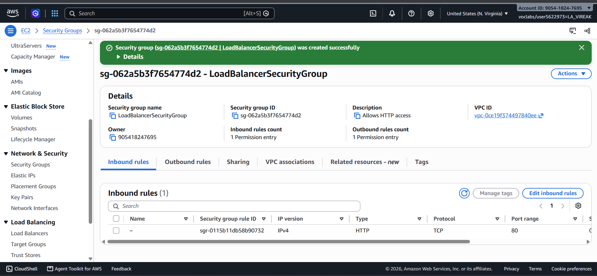

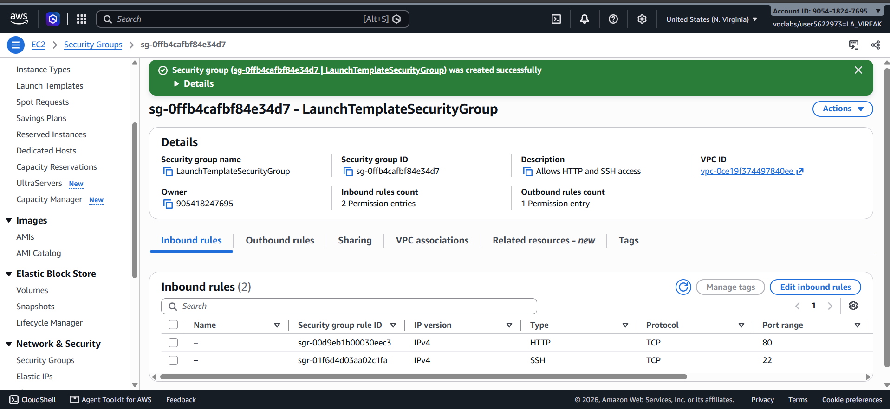

## Target group

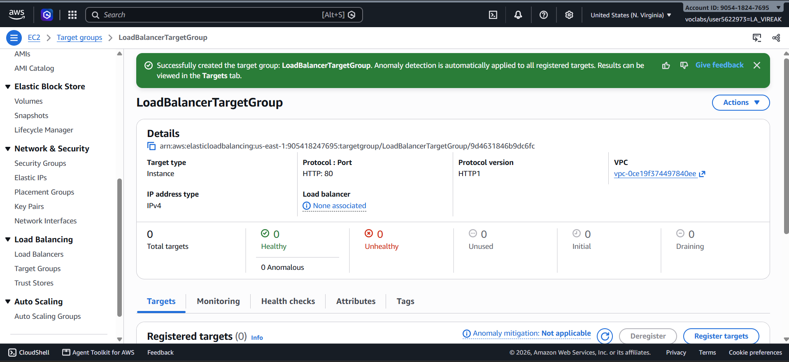

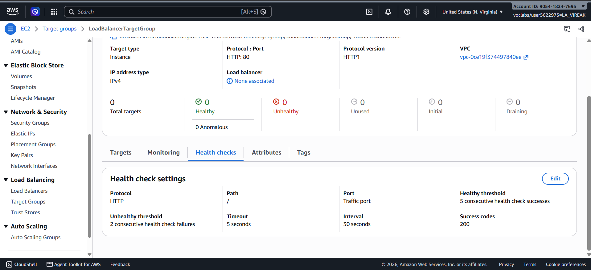

## Application Load Balancer

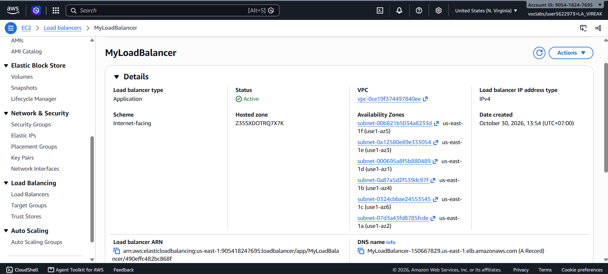

## Launch template

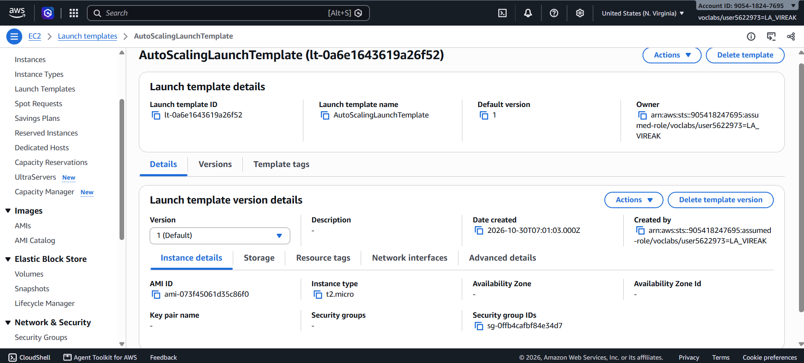

## Auto Scaling group

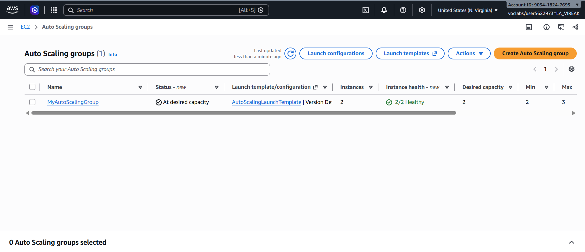

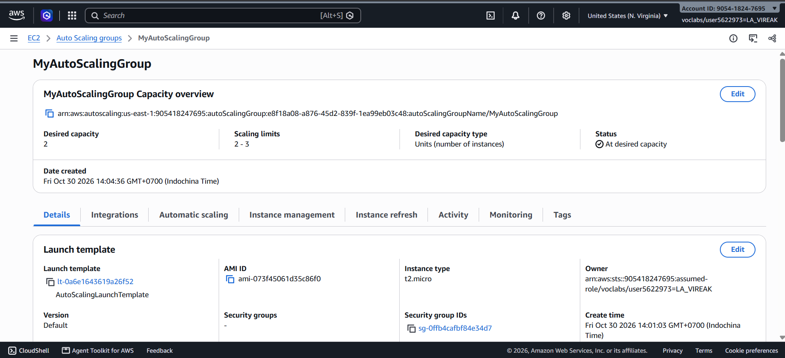

## Load balancing test

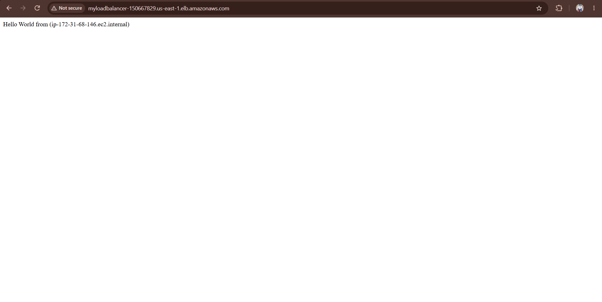

## Simulated application failure

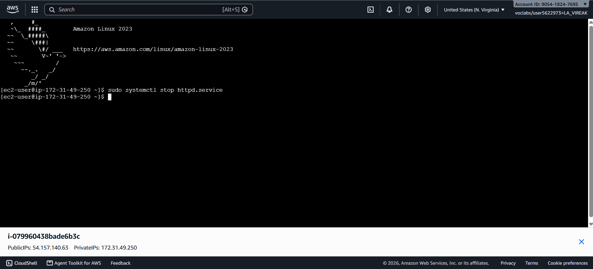

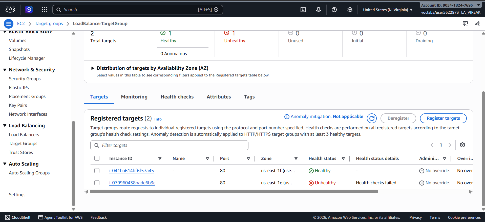

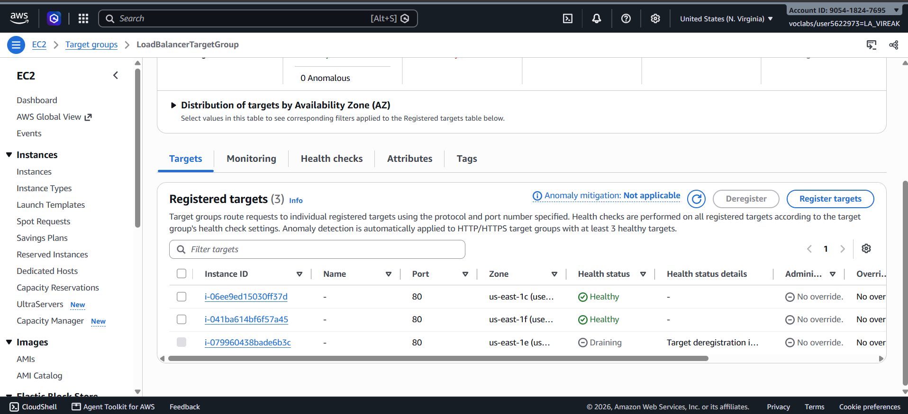

About how many minutes passed between stopping `httpd` and the new instance becoming healthy? **About 5 minutes.** I stopped `httpd` at 2:16 and the new instance was healthy at 2:21.

---

## Questions

1. Why does the page show a different host name when you refresh it?

   The load balancer spreads requests across the healthy targets in the target group. Each instance runs its own web server and prints its own host name, so a refresh that lands on the other instance shows a different name.

2. After you stopped `httpd`, the instance was still *running* in EC2, but the target group marked it *unhealthy*. What did the health check test, and why did the instance fail it?

   The health check sends an HTTP request to the instance on the configured port and path (`/`) and expects a success code (200). EC2 "running" only means the virtual machine is up. With `httpd` stopped nothing listens on port 80, so the request is refused or times out. After the unhealthy threshold of consecutive failures, the target is marked unhealthy.

3. Who replaced the failed instance: the load balancer, the target group, or the Auto Scaling group? Explain the role of each one.

   The Auto Scaling group replaced it.
   - **Load balancer:** receives client traffic and forwards it to healthy targets only. It does not create or remove instances.
   - **Target group:** holds the registered instances and runs the health checks. It reports which targets are healthy and stops routing to unhealthy ones.
   - **Auto Scaling group:** keeps the instance count at the desired capacity. Because ELB health checks are enabled on the group, it sees the unhealthy instance, terminates it, and launches a new one from the launch template, which registers itself in the target group.

4. With desired 2, minimum 2 and maximum 3, how many instances run normally? In what situation could there be 3?

   Normally 2 run. A third can exist only if scaling raises capacity above desired, for example a scaling policy triggered by high load, or during a replacement when the new instance launches before the unhealthy one is fully terminated. It never goes above the maximum of 3.

5. The instances' security group allows HTTP from anywhere. How could you change it so that the instances accept HTTP **only** from the load balancer?

   Edit the inbound HTTP (port 80) rule of the launch template's security group: remove the source `0.0.0.0/0` and set the source to the load balancer's security group (`LoadBalancerSecurityGroup`) instead of a CIDR range. Then only traffic from the load balancer reaches the instances.

## Problems and how I solved them (optional)

- My first `sudo systemctl stop httpd.service` failed with `Unit httpd.service not loaded`. I had connected to the Bastion Host instance, which has no web server. I reconnected to an instance listed in `LoadBalancerTargetGroup` and ran the command there.
- The load balancer address first gave `ERR_CONNECTION_TIMED_OUT`. I checked the load balancer's security group and that I was using `http://`, and the page loaded once the load balancer was active and the targets were healthy.

## AI note (optional)

## Clean up

- [x] `MyAutoScalingGroup` deleted and its instances terminated.
- [x] `AutoScalingLaunchTemplate` deleted.
- [x] `MyLoadBalancer` and `LoadBalancerTargetGroup` deleted.
- [x] Both security groups deleted.
