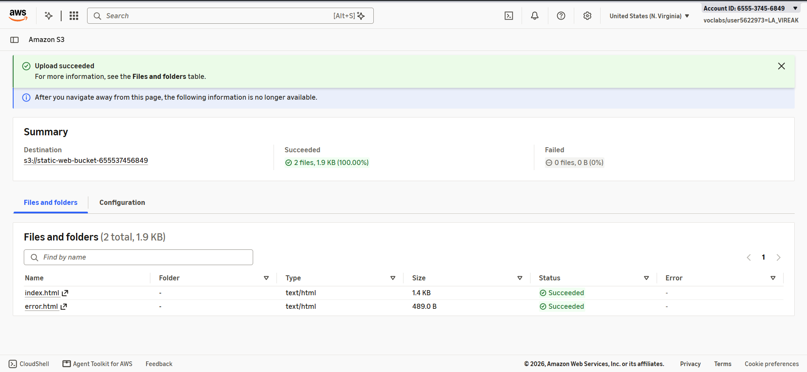
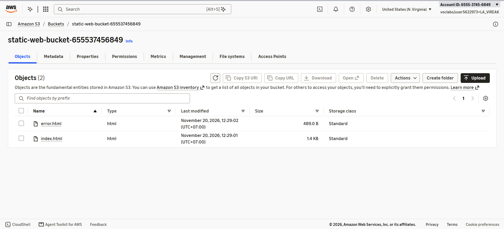
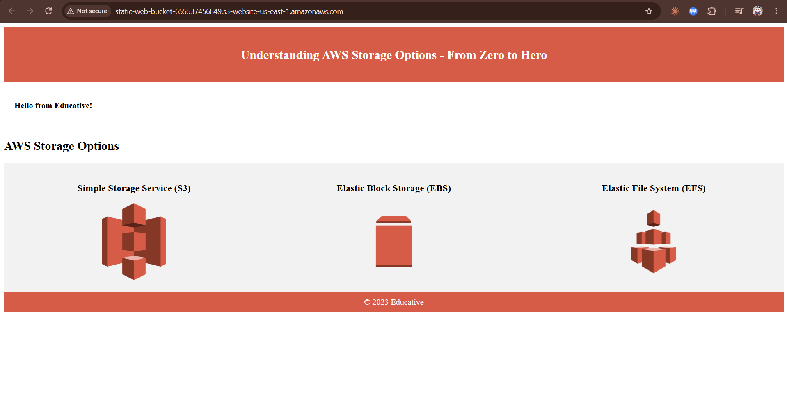
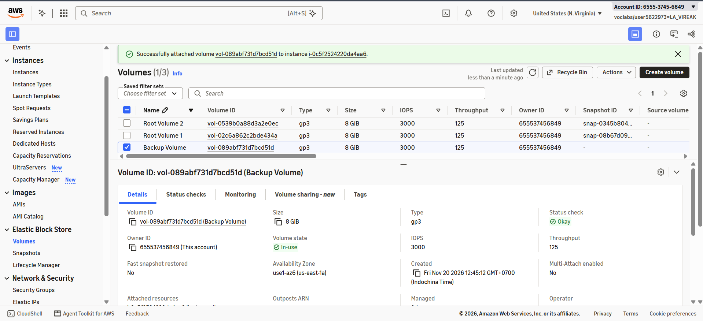
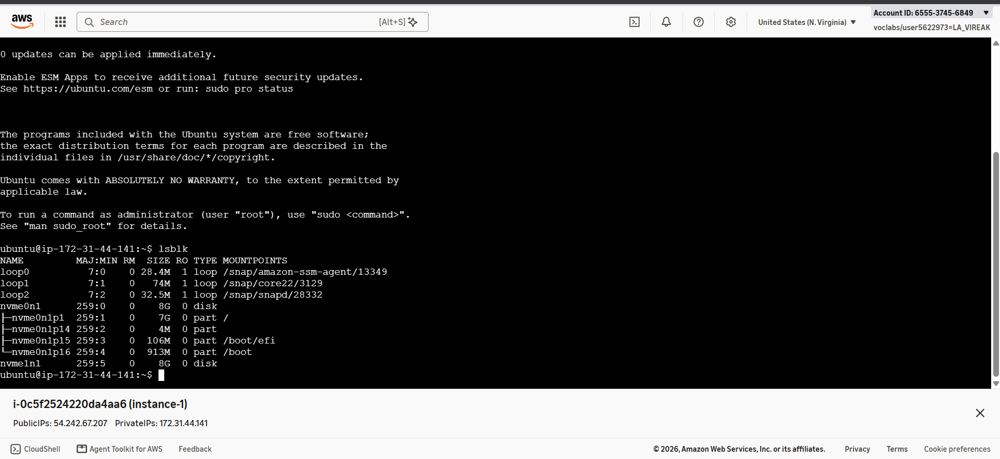
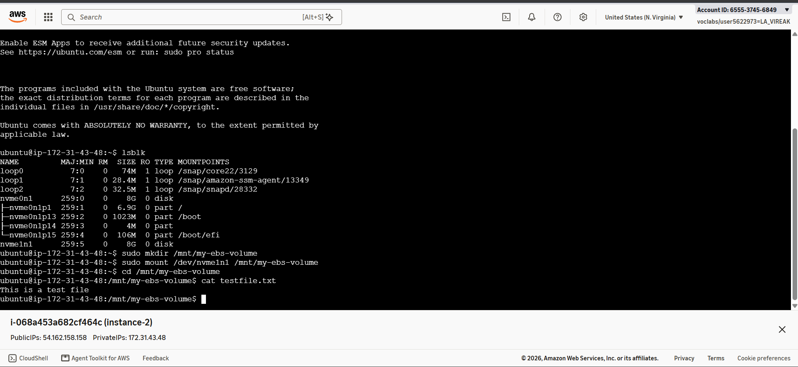
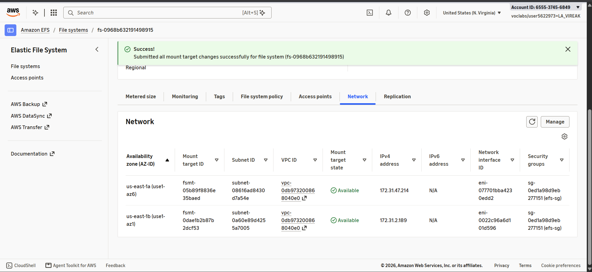
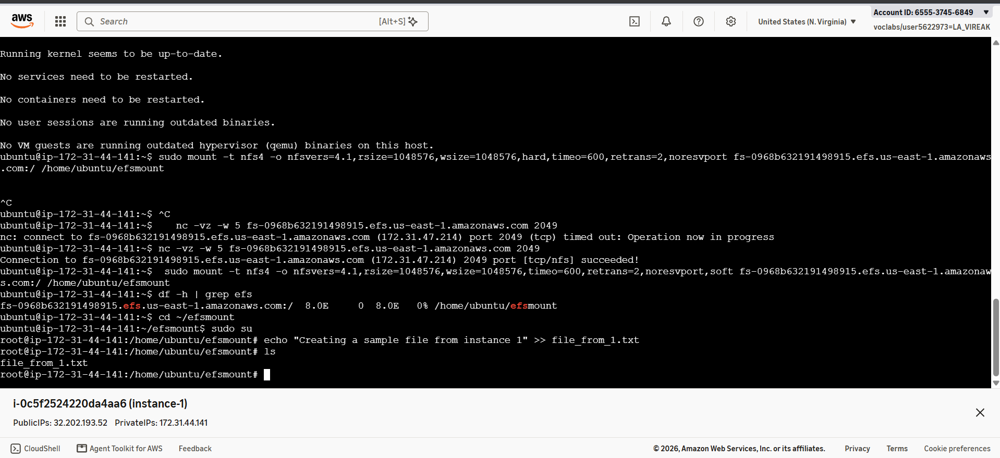
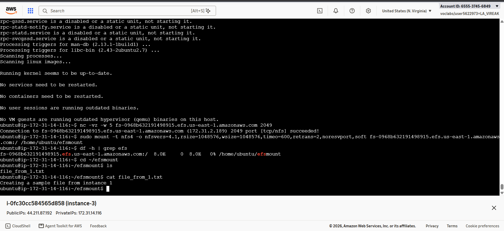

# Cloud Lab 3 Submission — AWS Storage Options

- **Student name:** La Vireak
- **Student ID:** e20251458
- **Learner Lab user name:** LA_VIREAK
- **Date completed:** 2026-11-20

---

## Part 2.1 — Amazon S3

### Bucket list

### Uploaded files

### Static website

---

## Part 2.2 — Amazon EBS

### Volumes page

### Attached volume (`lsblk`)

Which device name did your volume get (`xvdf`, `nvme1n1`, ...)?

`nvme1n1` (the instance is a t3, so EBS volumes appear as NVMe devices; the root volume is `nvme0n1`).

### File read on instance-2

---

## Part 2.3 — Amazon EFS

### File system and mount targets

### File created on instance-1

### File listed on instance-3

---

## Questions

1. After you turned on static website hosting, the endpoint first answered **403 Forbidden**. Why, and what changed after you added the bucket policy?

   Turning off Block Public Access only removes the safety block. It does not grant access. With no bucket policy and no ACL allowing it, S3 denies anonymous requests by default, so the endpoint answered 403. After I added the bucket policy (`Allow`, `Principal: *`, `s3:GetObject` on `<bucket-arn>/*`), anyone could read the objects, and the endpoint served `index.html`.

2. `testfile.txt` was still there after you moved **Backup Volume** to `instance-2`. What would have happened to a file saved on `instance-1`'s **root** volume after terminating `instance-1`?

   The root volume is deleted when its instance is terminated, so the file would be lost. Backup Volume is an additional volume: it persists independently of the instance, so it can be detached and attached to another instance with its data intact.

3. Why did you run `mkfs` on `instance-1` but not on `instance-2`?

   A new EBS volume is raw and has no file system, so it had to be formatted once with `mkfs` (ext4) before it could be mounted. After that it already had a file system holding `testfile.txt`. Running `mkfs` on `instance-2` would have erased the data, so I only mounted it.

4. Why could `instance-1` and `instance-3` use the EFS file system at the same time, when an EBS volume had to be detached first? Why did they have to be in the subnets of the mount targets?

   EFS is a network file system (NFS) built for parallel access, with file locking to keep data consistent, so many instances can mount it at once. An EBS volume is block storage that attaches to one instance at a time (like a disk), so it must be detached before another instance can use it. Instances reach EFS through a mount target, which gives an IP address for the NFS endpoint in one Availability Zone. Each instance connects through the mount target in its own AZ, so the instances need to be in the subnets (AZs) where mount targets exist.

5. For each need, choose S3, EBS or EFS and give one reason: (a) a website's images, (b) the disk of a database server, (c) a folder shared by several web servers.

   - (a) **S3**: cheap, scalable object storage that serves files directly over HTTP, so it suits static content such as images.
   - (b) **EBS**: low-latency block storage attached to one instance like a disk, which is what a database needs.
   - (c) **EFS**: a shared file system that many instances can mount and read/write at the same time.

## Problems and how I solved them (optional)

- **Pasted EBS commands ran together.** I pasted several commands at once, so some ran while `mkfs` was still working and the prompt was not in the mount folder. I checked with `lsblk` and `mount | grep my-ebs`, did not run `mkfs` again, then ran `cd`, `echo` and `cat` one at a time and confirmed `testfile.txt`.
- **EFS client build failed (disk full).** Building `amazon-efs-utils` filled the 8 GiB root disk (99.5% used) and the build failed, so `mount -t efs` gave `special device fs-... does not exist`. I freed space with `sudo apt-get clean` and by removing `~/.rustup`, `~/.cargo/registry` and `~/efs-utils/target`, then installed `nfs-common` and mounted EFS over NFS (`mount -t nfs4`) instead.
- **EFS mount timed out.** `nc -vz <fs-dns> 2049` timed out because both mount targets still used the `default` security group. I changed both mount targets to `efs-sg` (NFS, port 2049), and the mount worked.

## AI note (optional)

An AI assistant suggested mounting EFS with the plain NFS client (`nfs-common`, `mount -t nfs4`) after the `efs-utils` build failed. I checked it with `df -h | grep efs`, which showed the file system mounted, and by creating a file on `instance-1` and reading it on `instance-3`.

## Clean up

- [x] Instances `instance-1`, `instance-2`, `instance-3` terminated.
- [x] `clab-efs` and **Backup Volume** deleted.
- [x] Security groups `efs-sg` and `ec2instances-sg` deleted.
- [x] S3 bucket emptied and deleted.
