# Cloud Lab 4 Submission — Amazon VPC

- **Student name:** Vireak La
- **Student ID:** e20251458
- **Learner Lab user name:** `voclabs/user5622973=LA_VIREAK`
- **Date completed:** 2026-11-06

---

## VPC and internet gateway

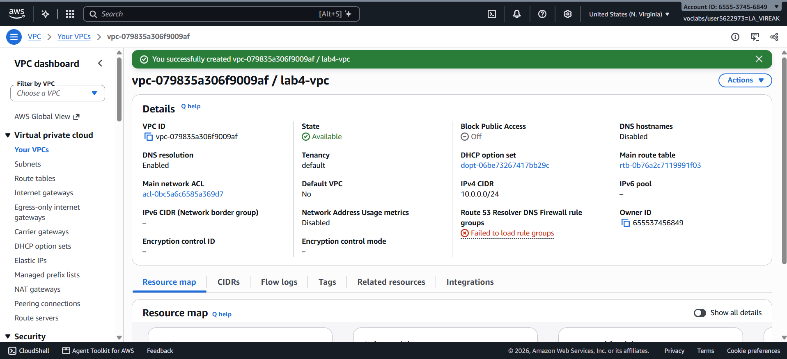

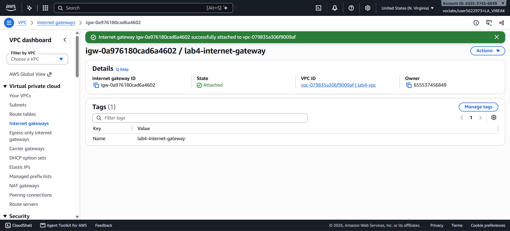

## Public subnet

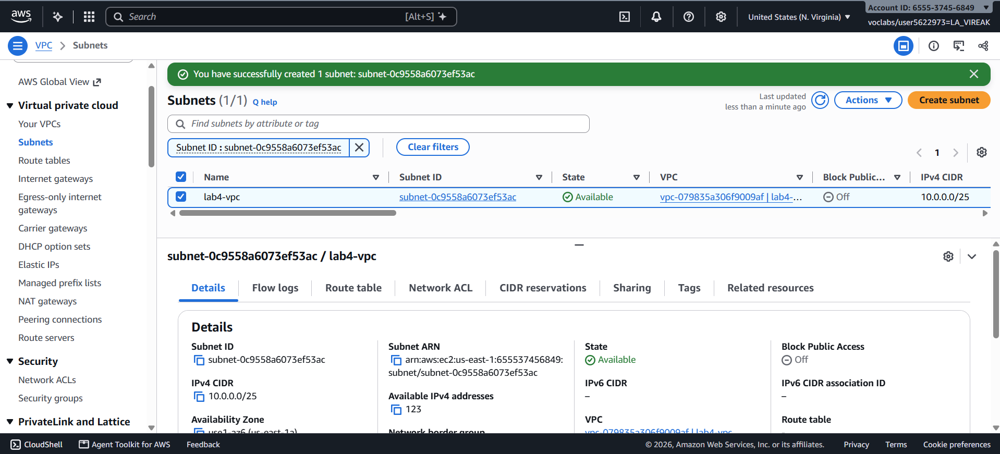

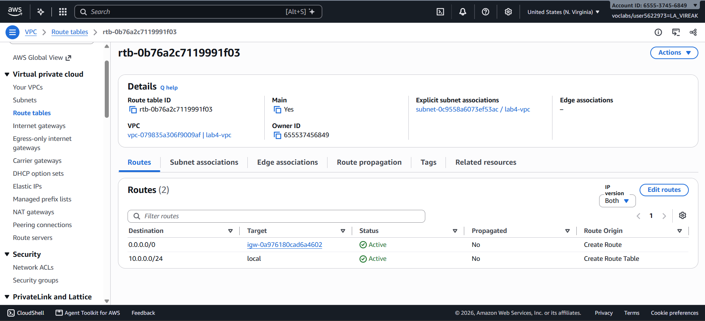

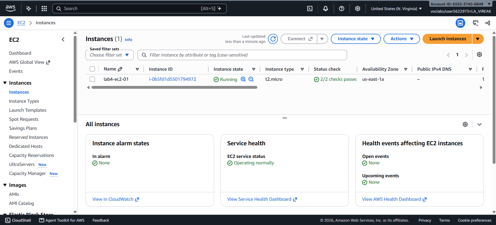

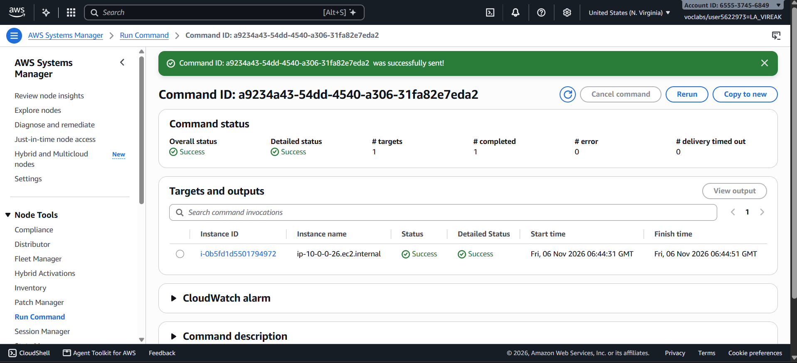

## Private subnet

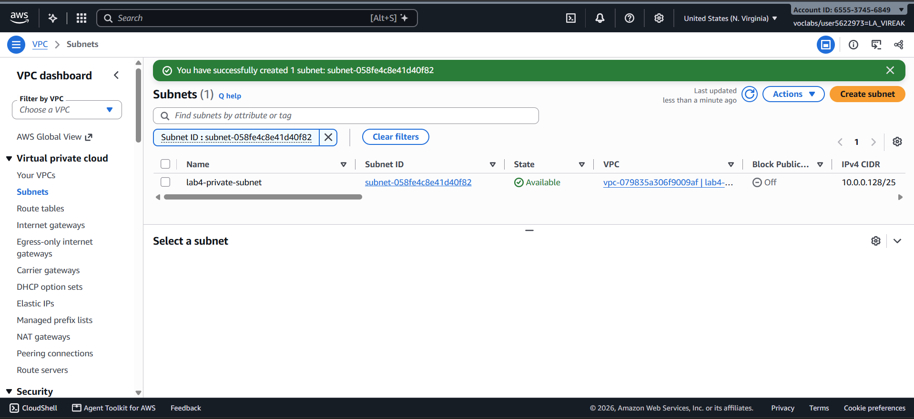

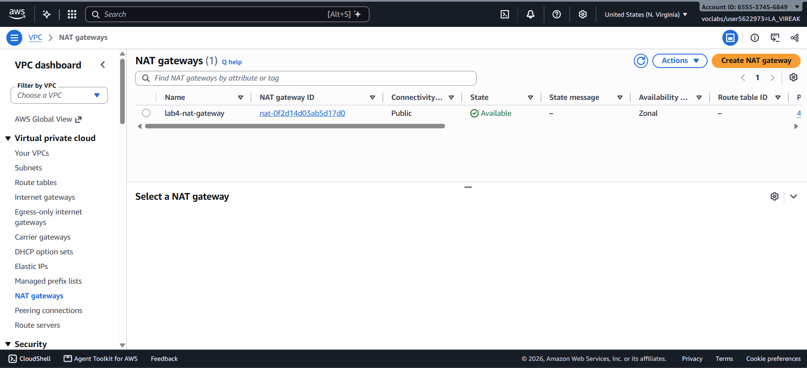

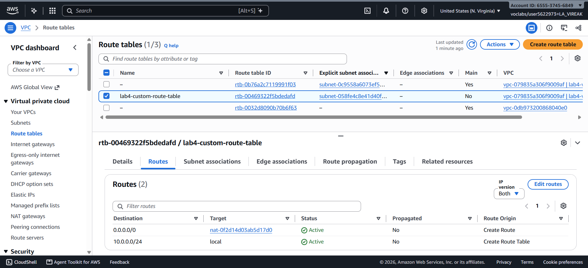

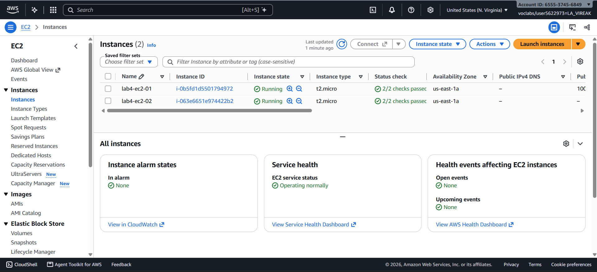

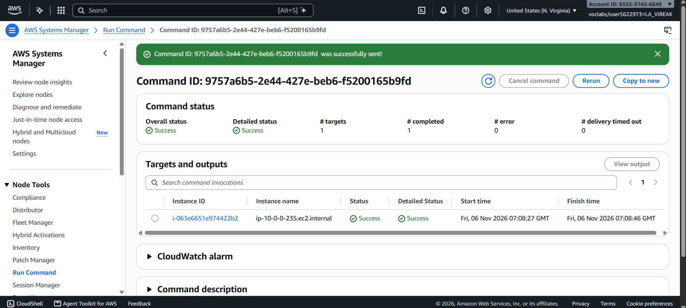

---

## Questions

1. The VPC is `10.0.0.0/24` and the subnets are `10.0.0.0/25` and `10.0.0.128/25`. How many IP addresses does each block contain, and why do the two subnets not overlap?

   **Answer:** A `/24` has 2^8 = 256 addresses. Each `/25` has 2^7 = 128 addresses (AWS reserves 5 in each subnet, so 123 are usable). `10.0.0.0/25` covers `10.0.0.0`–`10.0.0.127` and `10.0.0.128/25` covers `10.0.0.128`–`10.0.0.255`. The ranges share no address, so they do not overlap, and together they fill the whole VPC.

2. Both subnets are in the same VPC. What exactly makes `lab4-public-subnet` public and `lab4-private-subnet` private?

   **Answer:** The route table. `lab4-public-subnet` is associated with a route table that has `0.0.0.0/0` → internet gateway, so its instances can reach the internet directly. `lab4-private-subnet` is associated with `lab4-custom-route-table`, whose default route goes to the NAT gateway and not to the internet gateway, so nothing from the internet can start a connection to it.

3. Why is the NAT gateway placed in the **public** subnet and not in the private one?

   **Answer:** The NAT gateway must forward traffic out through the internet gateway, and only a subnet whose route table points to the internet gateway can do that. The NAT gateway also needs an Elastic IP as its public address. In the private subnet it would have no route to the internet gateway, so it could not reach the internet itself.

4. `lab4-ec2-02` has no public IP address. Can someone on the internet open a connection to it? Can it download updates? Explain both answers.

   **Answer:** No to inbound: it has no public IP and its subnet has no route to the internet gateway, so no one on the internet can address or open a connection to it. Yes to outbound: its traffic goes to the NAT gateway in the public subnet, which translates it to the Elastic IP and sends it through the internet gateway. Replies come back through the NAT gateway. This is why `sudo yum update -y` succeeded.

5. You tested internet access with Systems Manager instead of SSH. Why did the instances need `LabInstanceProfile` for this?

   **Answer:** Systems Manager needs permission to manage the instance. `LabInstanceProfile` (role `LabRole`) gives the instance the permissions its SSM Agent needs to register with Systems Manager and receive Run Command commands. Without it the instance would not appear in the target list. This needs no inbound rule and no key pair, because the agent connects outbound.

## Problems and how I solved them (optional)

- I started on the EC2 dashboard and could not find the VPC page. VPC is a separate service, so I searched for `VPC` in the console search bar.
- The NAT gateway form showed the subnet only as an ID (`subnet-...`) and had a new Regional/Zonal option. I chose **Zonal** and opened the Subnet dropdown to confirm the ID was `lab4-public-subnet`, not the private subnet.

## AI note (optional)

The AI tool suggested creating the NAT gateway in `lab4-public-subnet` and not in the private subnet. I checked this against the lab instructions and the architecture: the NAT gateway needs a route to the internet gateway, which only the public subnet has. I also compared the subnet ID in the dropdown with the ID of `lab4-public-subnet` before creating it.

## Clean up

- [x] Instances terminated.
- [x] NAT gateway deleted and its Elastic IP released.
- [x] Internet gateway detached and deleted.
- [x] `lab4-vpc` deleted.
