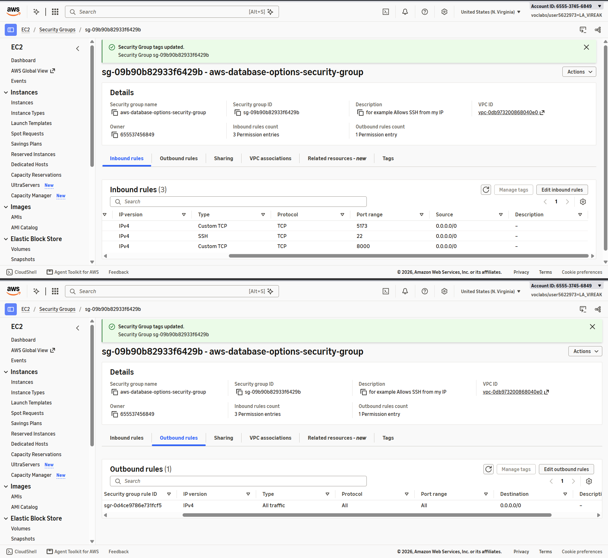
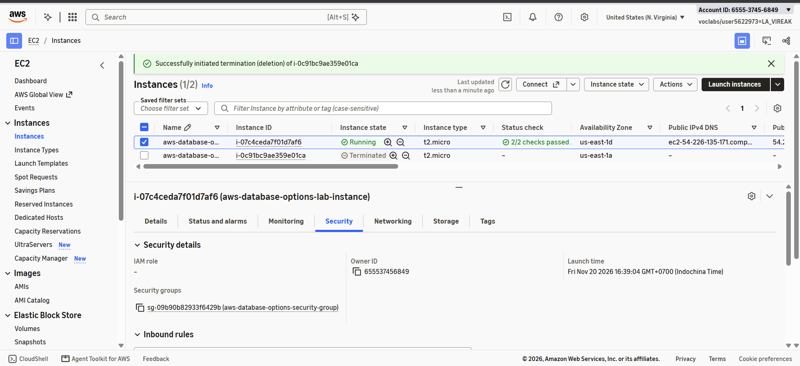
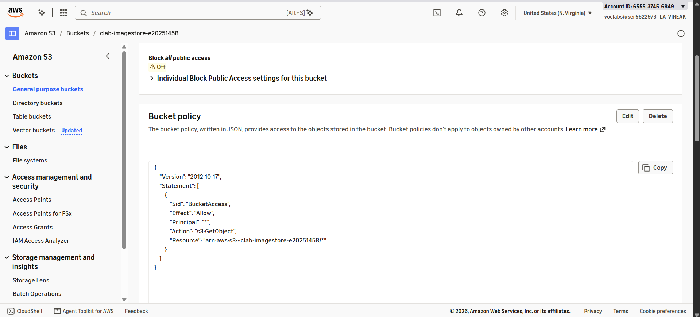
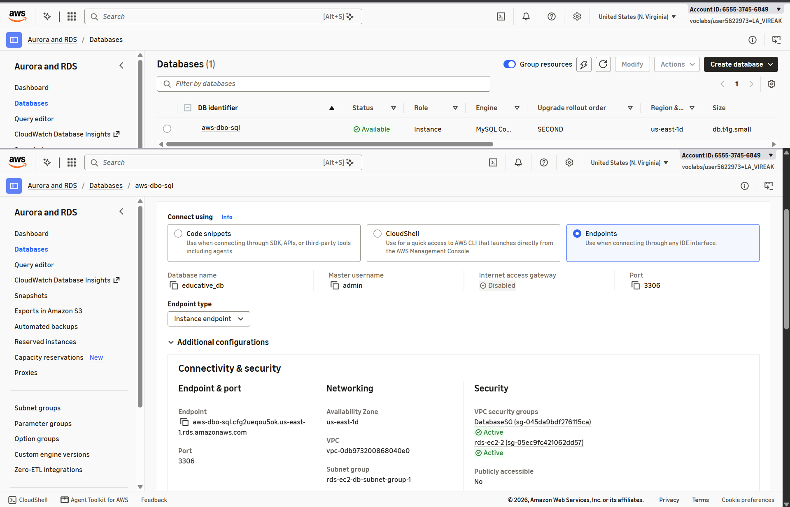
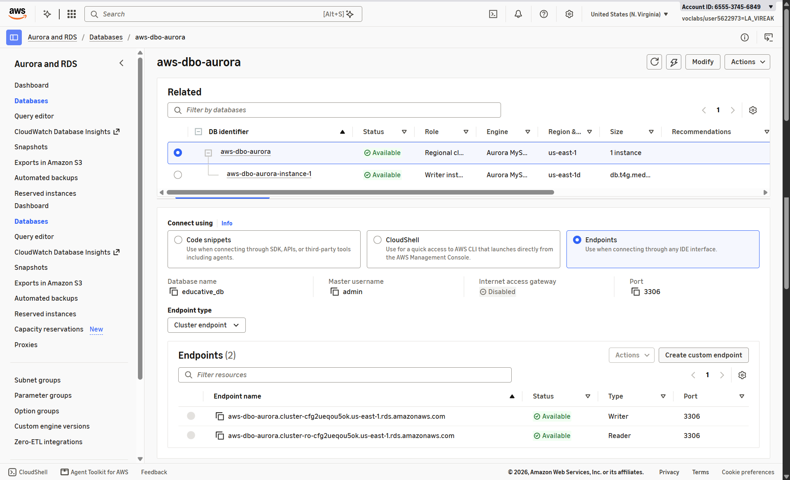
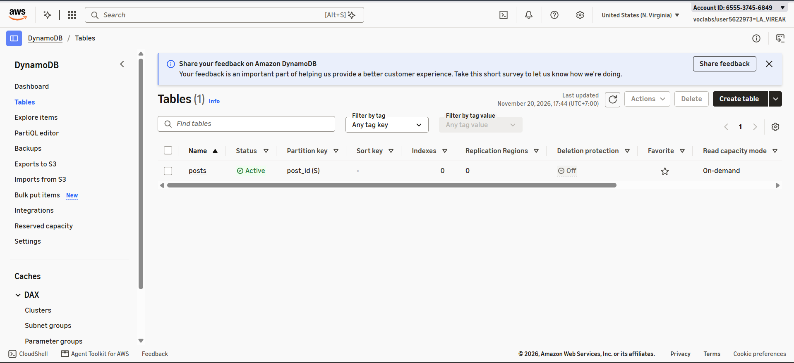
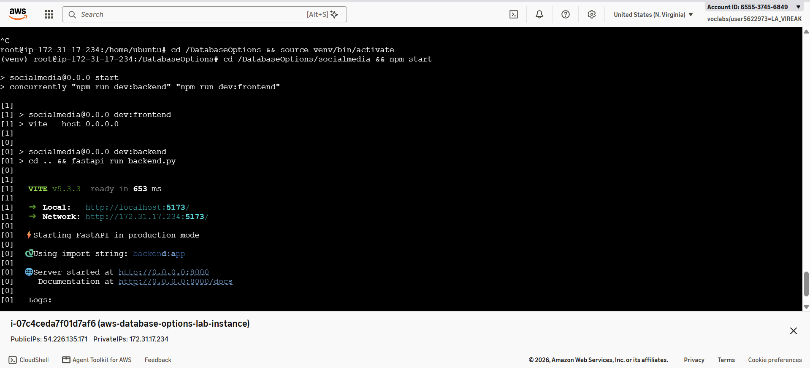
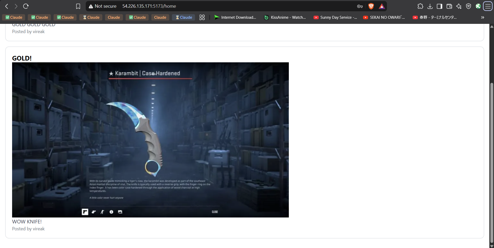
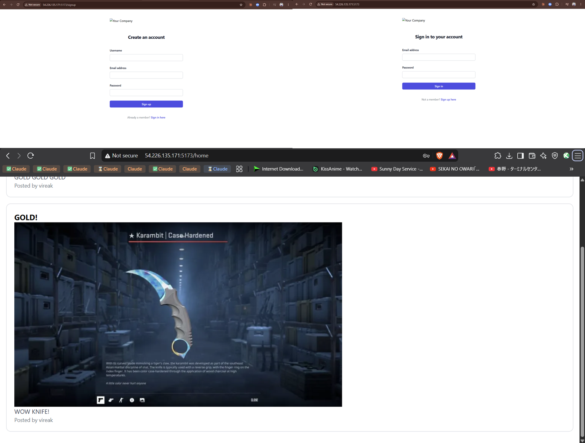
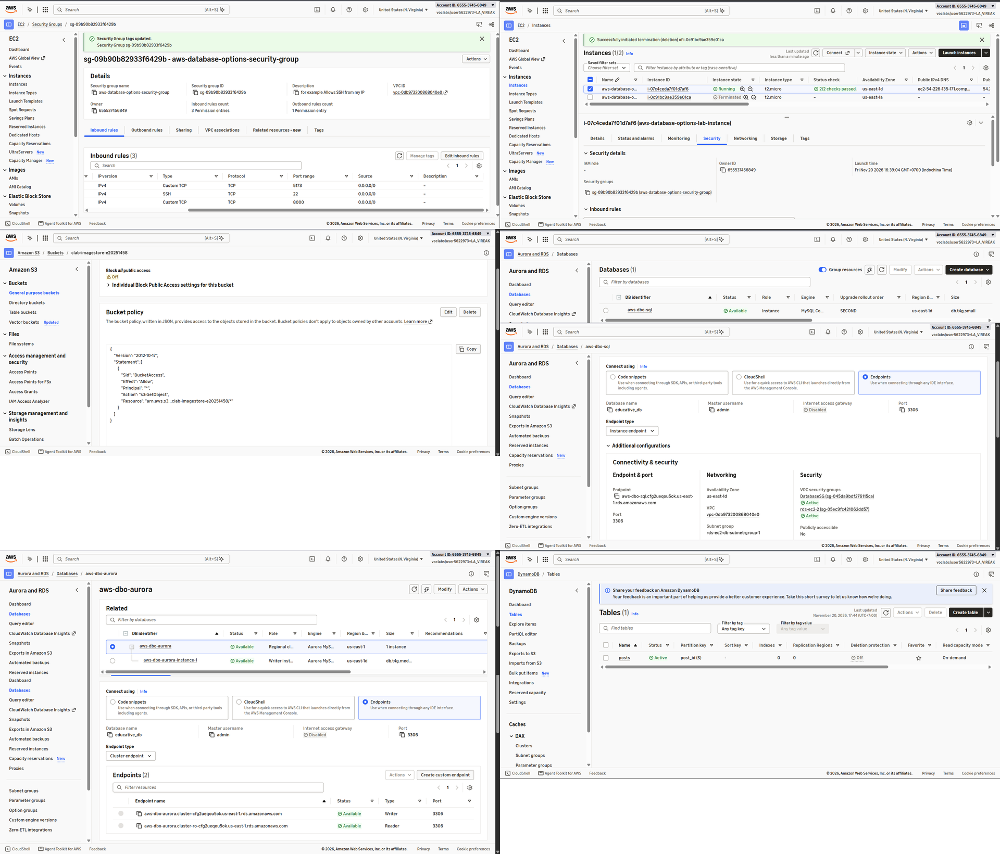

# Cloud Lab 5 Submission — AWS Database Lab

- **Student name:** La Vireak
- **Student ID:** e20251458
- **Learner Lab user name:** LA_VIREAK
- **Date completed:** 2026-11-20

Make sure resource names, statuses and endpoints are readable in every screenshot. Never show your database passwords or the AWS access key, secret key or session token.

---

## 1. Security Group Rules

`aws-database-options-security-group` with its inbound rules (SSH port 22, Custom TCP ports 8000 and 5173) and its outbound rule.

## 2. EC2 Instance Running

`aws-database-options-lab-instance` in the **Running** state with `aws-database-options-security-group` attached.

## 3. S3 Bucket

Your `clab-imagestore-e20251458` bucket with its public access settings and bucket policy visible.

## 4. RDS DB Instance

`aws-dbo-sql` with the status **Available** and its endpoint visible.

## 5. Aurora DB Status

The `aws-dbo-aurora` cluster with the status **Available** and its writer and reader endpoints visible.

## 6. DynamoDB Table

The `posts` table with the status **Active** and its partition key `post_id` visible.

## 7. Application Configuration and Testing

The EC2 instance terminal after `npm start`, showing that the application started.

The application running in your browser at `http://54.226.135.171:5173`, with the address bar visible.

The signup page, the sign-in page and a sample post.

## 8. Final Infrastructure

One collage of the resources you created: EC2 instance, security group, RDS and Aurora databases, DynamoDB table and S3 bucket.

## Errors and troubleshooting (optional)

- **`CreateDBInstance` denied.** The first RDS attempts failed with `not authorized to perform: rds:CreateDBInstance ... explicit deny in an identity-based policy`. The Learner Lab only allows specific settings. I used exactly `db.t4g.small`, General Purpose SSD (gp2) and 20 GiB for RDS, and `db.t4g.medium` for Aurora.
- **MySQL 8.0 end of support.** `mysql-8.0.46 reached RDS end of standard support ... requires engine lifecycle support: open-source-rds-extended-support`. I kept the default engine version (MySQL 8.4) instead of 8.0.
- **Enhanced Monitoring.** Creating the monitoring role is not allowed in the Learner Lab, so I unticked **Enable Enhanced Monitoring** for RDS and Aurora.
- **EC2 Instance Connect failed** with `Error establishing SSH connection to your instance`. The instance was still busy running the user data install script on a `t2.micro`. I rebooted the instance and connected again after a few minutes.
- **First page load was slow.** Vite runs in development mode on a `t2.micro`, so the first load of `http://54.226.135.171:5173` took several seconds.

## Questions

1. Signup writes to the Aurora **writer** endpoint and login reads from the **reader** endpoint. Your cluster has no Aurora Replica. Which instance answers the reader endpoint, and why does the application still work?

   The cluster has only one DB instance, `aws-dbo-aurora-instance-1`, which is the writer. With no replica, the reader endpoint falls back to that same instance, so it answers both endpoints. The application still works because the writer can serve reads as well as writes, and login finds the account that signup just wrote.

2. A post is split between the `user_post` table in RDS and the `posts` table in DynamoDB. What does each one store, and how does `/get_posts` join them?

   RDS `user_post` stores only the post `id` (username + time) and the author's `username`. DynamoDB `posts` stores the post details under the partition key `post_id`: `title`, `content` and the optional `media` URL. `/get_posts` first reads the post IDs from `user_post`, then calls `get_item` in DynamoDB with each ID as `post_id`, and merges the SQL row (the author) with the DynamoDB item (title, content, media) into one list.

3. The post ID is the username followed by the time (`%H:%M:%S`). What happens if the same user publishes two posts in the same second, or on two different days at the same time?

   In both cases the two posts get the same ID, because the ID has no date and only second precision. `id` is the primary key of `user_post`, so the second `INSERT` fails with a duplicate-key error and the app returns an error: the second post is rejected, even if it is on another day. This happens before the DynamoDB write, so the existing post is not overwritten.

4. Why does the post content go into DynamoDB instead of a SQL table, according to the lab's database design?

   The content of posts varies from post to post: some have a media file and others do not. DynamoDB is a NoSQL database with a flexible schema, so each item can have different fields. SQL tables need the same structured columns for every row, which suits users and the user-to-post relation.

5. The `users` table stores the password exactly as the user typed it, and the S3 bucket allows anyone to read its objects. Name one risk of each choice.

   - **Plain-text passwords:** anyone who reads the database (or a backup or log) sees every password, which users often reuse on other sites. Passwords should be stored as salted hashes.
   - **Public S3 bucket:** anyone with an object URL can read the files, so uploaded images cannot be kept private, and every download costs bandwidth.

## Clean up

- [x] EC2 instance terminated and `aws-database-options-security-group` deleted.
- [x] RDS instance `aws-dbo-sql` and Aurora cluster `aws-dbo-aurora` deleted.
- [x] S3 bucket emptied and deleted.
- [x] DynamoDB table `posts` deleted.
